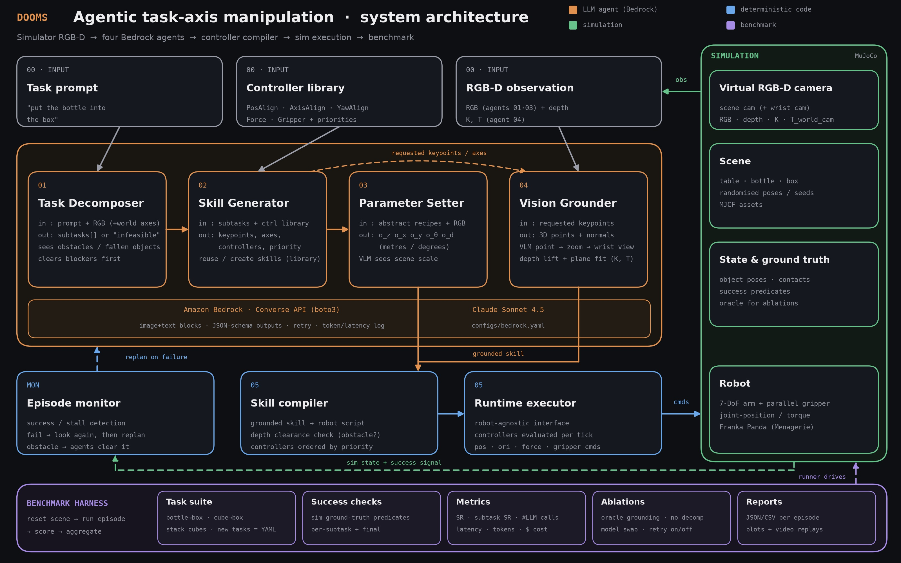

# Dooms-inference

Agentic task-axis manipulation in simulation: a task prompt + an RGB-D image from a simulated camera go
through four Claude agents on Amazon Bedrock, are compiled into task-axis controller skills, and executed
on a Franka Panda in MuJoCo. A benchmark harness scores it.



```
prompt + RGB-D ─► 01 Task Decomposer ─► 02 Skill Generator ─► 03 Parameter Setter ─┐
                                              │ requested keypoints                  ├─► compile ─► runtime ─► MuJoCo
                                              └──────────────► 04 Vision Grounder ───┘   (PosAlign / AxisAlign / YawAlign / Force / Gripper)
```

## Setup
```bash
uv venv .venv --python 3.11 && uv pip install --python .venv/bin/python -e ".[dev]"
cp .env.example .env        # then fill in AWS credentials (or AWS_BEARER_TOKEN_BEDROCK)
```
Model: Claude Sonnet 4.5 through the cross-region inference profile
`us.anthropic.claude-sonnet-4-5-20250929-v1:0` (edit `configs/bedrock.yaml`, or pass `--model`; use the
`global.` prefix if that is what your account has enabled). Bedrock model access for Sonnet 4.5 must be enabled.

## Run
```bash
# no AWS needed: scripted reference plan + simulated noisy VLM pointing (exercises the whole stack)
.venv/bin/python scripts/run_task.py --task put_bottle_in_box --seed 0 --llm scripted

# real agents on Bedrock
.venv/bin/python scripts/run_task.py --task put_bottle_in_box --seed 0 --llm bedrock

# benchmark: tasks x seeds x ablations  ->  runs/bench_bedrock/{episodes.jsonl,summary.md,summary.csv,success_rate.png}
.venv/bin/python scripts/run_benchmark.py --llm bedrock --seeds 20 \
    --tasks put_bottle_in_box put_cube_in_box stack_cubes \
    --variants baseline oracle_grounding no_refine no_retry no_decomposer

.venv/bin/python -m pytest -q
```
Each episode writes `scene.png`, `plan_*.json` (subtasks, recipes, parameters), `*_grounding.png` (points the VLM
picked), `transcript.json` (every agent answer), `result.json`, `video.mp4` under its run directory.

## Web UI (type a command, watch the sim)
The page is a small studio: **command panel** (task, scene, planner, advanced options) · **live 3D simulation** with the
agents' camera as an inset and a step-by-step progress bar · **tabs** for the agent pipeline, the skill library and an
activity log with cost/token metrics.

**Bring your own AWS account.** Click *Connect AWS* (top right), paste IAM access keys (optionally a session token) or an
Amazon Bedrock API key, pick a region and press *Validate & connect*. The server checks the credentials, lists the Claude
models the account can use and lets you choose one. Keys are kept in memory for your session (optionally in your browser
storage if you tick *Remember on this device*), are sent only with your own run requests, and are never written to disk or
logs. For a hosted deployment set `DOOMS_REQUIRE_USER_KEYS=1` so the server's own credentials are never used, and serve it
over HTTPS. Use an IAM user limited to `bedrock:InvokeModel` and `bedrock:ListInferenceProfiles`.

```bash
.venv/bin/python scripts/serve.py            # then open http://127.0.0.1:8000  (--port N if 8000 is busy)
```
Pick a scene (`sandbox` has a bottle, a box, a red and a blue cube), type a command or click an example, press
Run. The main view is a **live 3D scene** (three.js): the server streams the pose of every body 50x per second
and the browser draws the real Panda meshes, so you can orbit / pan / zoom while the robot moves. Orange markers
show where the Vision Grounder put each keypoint (with its surface normal); the small inset is the agents' camera
image. The side panels fill in live: decomposed subtasks, controller recipes (with the chosen numbers), parameters,
grounding overlay, LLM calls / tokens / cost, and the final verdict. Planner **Demo** needs no AWS and understands
"put X into/on Y" for the scene's objects; planner **Claude · Bedrock** takes any wording (needs credentials in
`.env`). Grounding **Oracle** uses simulator truth. The speed selector paces the sim (max = as fast as possible).
**The scene is a persistent session**: each browser tab gets its own simulator process, and the world state is
kept between commands. Run "put the bottle into the box", then "put the blue cube into the box": the second
command starts with the bottle already in the box (the arm first returns home). The scene only changes when you
press **↺ Reset scene**, change the scene, or change the seed. Stop aborts the running command and leaves the
world as it is. If the destination tray is already occupied, grounding aims at its free floor; gripper clearance
in a crowded tray is limited, so a neighbouring object can occasionally get nudged.
The 3D viewer loads three.js from a CDN, so the browser needs internet access. The server binds to 127.0.0.1
only and runs one episode at a time, each in its own process.

## Skills, obstacles, fallen objects
* **Skill library** (`skills/library/*.json`, starts empty): a skill is a reusable recipe with roles (`obj`, `dest`, ...)
  instead of object names, e.g. `grasp_from_above`. For every subtask the Skill Generator sees the stored skills and
  either reuses one or defines a new one; new skills are saved only after a successful run, reused ones keep
  success counts and the numbers that worked (offered to the Parameter Setter as hints). Shown on the web page
  (Skills: Learn + reuse / Off; "clear" deletes them). CLI: `--skills DIR|none`. Ablation: `no_skill_library`.
* **Open vocabulary keypoints**: the Skill Generator may define any keypoint with a description (a free spot on the
  table, the far end of a lying bottle...); the Vision Grounder points at it. Directions between two keypoints
  (`A__to__B`) are usable as task axes.
* **Obstacle analysis**: before acting, a depth-based clearance check (`perception/clearance.py`) measures whether the
  open fingers would hit a neighbouring object at each grasp target. If blocked, the Task Decomposer receives the
  measurement (world coordinates, size, side), decides how to clear it (e.g. push the box away with the closed
  gripper, built from the same controllers) and the original task is planned again from the new scene.
  The planning agents see the world axes drawn on the image. The box is a free body (0.65 kg) so it can be pushed.
* **Fallen objects / infeasible tasks**: the Task Decomposer describes object states first; a lying bottle is grasped
  across its width; if the task cannot be done with a top-down parallel gripper it says so instead of trying.
* Scenes: `sandbox`, `sandbox_fallen` (bottle knocked over), `sandbox_blocked` (box right beside a lying bottle).

## Metrics
success rate (Wilson 95% CI), subtask completion, replans, LLM calls / tokens / cost / latency, sim + wall time,
mean grounding error vs simulator ground truth (mm). Ablations (`bench/ablations.py`): `oracle_grounding`
(simulator keypoints), `no_refine` (no zoom pass), `no_retry`, `no_decomposer`.

## Layout
`src/dooms/`: `llm/` (Bedrock client, schemas, prompts) · `agents/` (the 4 agents) · `pipeline.py` ·
`controllers/` (task-axis controllers, priority stack) · `perception/` (back-projection, keypoints, tracking) ·
`sim/` (MuJoCo env, Panda scene builder) · `execution/` (compiler, runtime, robot interface) · `monitor.py` ·
`bench/` · `server/` (FastAPI + WebSocket + `static/index.html`). Add a task by dropping a YAML in `configs/tasks/`.

## Design notes
* Keypoints are grounded **once per plan** from a clean initial image, then tracked: after the gripper closes,
  keypoints near the tcp follow the end-effector kinematically (no need to see through the gripper); on release
  they freeze. Grounding is coarse VLM pointing, a zoomed refinement, then depth lift + plane fit.
* **Precision loop** (the main accuracy lever): grasping needs the target to ~5 mm, so grounding is coarse-to-fine -
  scene camera (coarse point, zoomed refinement, depth + plane fit), then a **wrist-camera close-up** once the gripper
  hovers above a reach target. If a subtask fails, the pipeline first does *targeted feedback* (go home, look again
  with a little sampling variation, re-run the same plan; `max_regrounds`), and only then a full LLM replan.
  Ablations: `no_wrist_refine`, `no_regrounding`.
* The runtime stacks controllers by priority with exact null-space projection; a posture task keeps the arm near home.
* On failure (timeout / missed grasp / dropped object) the monitor triggers a retry, then a replan from the
  current scene (arm returns home first).
* Swapping simulator/robot: implement `sim.base.RobotInterface` / `SimEnv`.

## Status
Verified in simulation with the scripted stand-in for the LLM (12/12 bottle→box, 12/12 cube→box, 11/12 stacking with
simulated 6 px / 1 px pointing noise). **The live Bedrock path has not been run yet** (no credentials were
available while building): the request shape is covered by a unit test against a fake client; the prompts and the
VLM pointing accuracy on real Claude answers are untested.
