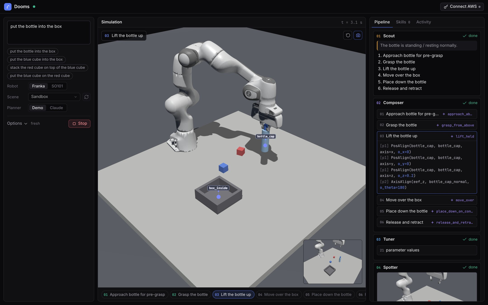

# Dooms

Tell a robot arm what to do in one sentence. Four Claude agents turn the sentence and one RGB-D camera frame into
task-axis controller skills, and a MuJoCo simulation (or a real SO-101) runs them. No demonstrations, no training.

**Live demo: https://dooms-inference.vercel.app** (the simulator runs in your browser; the built-in demo planner
needs no account).



## How it works

```
sentence + RGB-D frame ─► Scout ─► Composer ─► Tuner ─┐
                                      │ keypoints      ├─► compile ─► controller stack ─► arm
                                      └────► Spotter ──┘   (PosAlign / AxisAlign / YawAlign / Force / Gripper)
```

| Agent (UI name) | Name in the code | Job |
| --- | --- | --- |
| Scout | `task_decomposer` | Describes the scene, splits the task into ordered subtasks, or says the task is infeasible |
| Composer | `skill_generator` | Reuses a stored skill or writes a controller recipe for each subtask, naming the keypoints it needs |
| Tuner | `parameter_setter` | Sets every number in the recipes (heights, forces, widths) |
| Spotter | `vision_grounder` | Points at each keypoint in the image, refines it, and lifts it to 3D with depth and a plane fit |

The agents' typed answers are compiled into a priority stack of task-axis controllers that runs at control rate with
no model in the loop. A monitor watches each subtask; on failure the pipeline looks at the scene again, and only then
replans. Full diagram: [docs/architecture.jpg](docs/architecture.jpg) (it uses the code names).
Design notes: [docs/ARCHITECTURE.md](docs/ARCHITECTURE.md).

## Results

All numbers are **simulation only**, scored by the simulator's ground-truth predicate (`inside` / `on_top`), all or
nothing. Nothing here was measured on physical hardware.

### Claude Sonnet 4.5 on Amazon Bedrock, 30 seeds per task

| Task | Arm | Solved | 95% CI | Model calls | Cost | Planning time |
| --- | --- | --- | --- | --- | --- | --- |
| Put the bottle in the box | Franka Panda | 30 / 30 | 89%-100% | 8.3 | $0.131 | 60 s |
| Put the red cube in the box | Franka Panda | 29 / 30 | 83%-99% | 8.0 | $0.133 | 62 s |
| Stack red on blue | Franka Panda | 29 / 30 | 83%-99% | 8.0 | $0.131 | 61 s |
| Blue cube in the box, cluttered table | Franka Panda | 29 / 30 | 83%-99% | 8.2 | $0.136 | 64 s |
| Stack blue on red, cluttered table | Franka Panda | 25 / 30 | 66%-93% | 8.0 | $0.130 | 60 s |
| Put the red cube in the box | SO-ARM101 | 21 / 30 | 52%-83% | | | |
| Stack red on blue | SO-ARM101 | 18 / 30 | 42%-75% | | | |

* **Franka Panda: 142 / 150 (94.7%, 95% CI 89.8%-97.3%).** In every miss the arm finished its plan but the object
  did not end up in place.
* **SO-ARM101: 39 / 60 (65%).** Most failures are the arm timing out on its approach to the cube. With the scripted
  planner the same arm solves 98 / 100, so the gap is in Claude's plans and pointing for the small arm, not in the
  controllers.
* About a minute per task is model latency (roughly 8 calls of 7.6 s); the robot motion itself is about 9 s.
* The whole run (210 episodes) cost about $32. Cost is computed from token counts at list price.

### Scripted reference planner, 50 seeds per task

The scripted planner replaces Claude with a hand-written plan and simulated pointing noise (6 px, 1 px after
refinement), so it measures grounding, control and execution without planning: **348 / 350** across the same seven
set-ups (Franka 250 / 250, SO-ARM101 98 / 100).

Raw summaries: [docs/trials_claude.md](docs/trials_claude.md), [docs/trials_scripted.md](docs/trials_scripted.md).
Reproduce:

```bash
.venv/bin/python scripts/run_trials.py --llm scripted --seeds 50     # free, about 2 minutes
.venv/bin/python scripts/run_trials.py --llm bedrock  --seeds 30     # paid Bedrock calls, about 45 minutes
```

## Quick start

### In the browser

Open https://dooms-inference.vercel.app, press **Run the demo**. To plan with Claude, open the studio, click
**Connect Claude** and add one of:

* a **Claude API key** (calls go to `api.anthropic.com`; Claude Opus 5.5, Sonnet 5.5 or Haiku 5.5), or
* **Amazon Bedrock** credentials: AWS access keys or a Bedrock API key (Claude Sonnet 4.5).

Requests go from your browser straight to the provider you chose and are billed to you. Keys stay in the browser
tab (or in browser storage if you tick *Remember on this device*) and are never sent to a Dooms server.

### Python

```bash
uv venv .venv --python 3.11 && uv pip install --python .venv/bin/python -e ".[dev,web]"
cp .env.example .env        # AWS credentials (or AWS_BEARER_TOKEN_BEDROCK); only needed for --llm bedrock

# no AWS needed: scripted reference plan + simulated noisy pointing (exercises the whole stack)
.venv/bin/python scripts/run_task.py --task put_bottle_in_box --seed 0 --llm scripted

# real agents on Bedrock
.venv/bin/python scripts/run_task.py --task put_bottle_in_box --seed 0 --llm bedrock

.venv/bin/python -m pytest -q
```

The Python stack uses Claude Sonnet 4.5 through the cross-region inference profile
`us.anthropic.claude-sonnet-4-5-20250929-v1:0`. Edit `configs/bedrock.yaml` or pass `--model`; use the `global.`
prefix if that is what your account has enabled. Model access for Sonnet 4.5 must be enabled in Bedrock.

Each episode writes `scene.png`, `plan_*.json` (subtasks, recipes, parameters), `*_grounding.png` (the points the
model picked), `transcript.json` (every agent answer), `result.json` and `video.mp4` under its run directory.

## Browser engine

The web UI runs the whole stack in the page: MuJoCo compiled to WebAssembly, the controllers, the four agents and
the vision grounder live in a web worker (`web/engine/`, a TypeScript port of the Python stack). Claude is called
from the worker with the visitor's own credentials, through `@anthropic-ai/sdk` for a Claude API key or a SigV4-signed
Bedrock Converse call. The skill library is kept in IndexedDB. Hosting is static files.

```bash
npm install && npm run build      # bundles web/ -> src/dooms/server/static/engine/ (committed; rebuild after editing web/)
npm run typecheck
npm run prompts                   # regenerate web/engine/prompts.ts after editing src/dooms/llm/prompts/*.md
.venv/bin/python scripts/serve.py # http://127.0.0.1:8000  (--port N if 8000 is busy)
```

* `/` is the project page; the studio is `/static/studio.html`.
* The Python server is only needed for a **real robot** (a web page cannot reach a USB arm). The UI talks to it over
  a WebSocket in that mode alone, and real-robot runs plan through Bedrock.
* Robot assets for the browser are slimmed copies under `src/dooms/server/static/dooms/`.
* Deploying: `vercel.json` builds the engine and publishes the static UI (`scripts/vercel_build.py`). No backend or
  environment variable is required; `DOOMS_API_URL` is optional and only points the UI at a real-robot server.

### The studio

A command panel (task, robot, scene, planner), a live 3D view with the agents' camera as an inset, and tabs for the
agent pipeline, the skill library and an activity log with cost and token counts.

* Planner **Demo** needs no account and understands "put X into/on Y" for the scene's objects. Planner **Claude**
  takes any wording.
* Grounding **Oracle** uses simulator truth; **Vision** has Claude point at the camera image.
* **The scene is a persistent session.** Run "put the bottle into the box", then "put the blue cube into the box":
  the second command starts with the bottle already in the box. The world only changes when you reset the scene,
  change the scene or change the seed. Stop aborts the running command and leaves the world as it is.
* The 3D viewer loads three.js from a CDN, so the browser needs internet access.

## Skills, obstacles, fallen objects

* **Skill library** (`skills/library/*.json` in Python, IndexedDB in the browser): a skill is a reusable recipe with
  roles (`obj`, `dest`, ...) instead of object names, e.g. `grasp_from_above`. For every subtask the Composer sees the
  stored skills and either reuses one or defines a new one. New skills are saved only after a successful run; reused
  ones keep success counts and the numbers that worked, offered to the Tuner as hints. CLI: `--skills DIR|none`.
* **Open-vocabulary keypoints**: the Composer may define any keypoint with a description (a free spot on the table,
  the far end of a lying bottle) and the Spotter points at it. Directions between two keypoints (`A__to__B`) are
  usable as task axes.
* **Obstacle analysis**: before acting, a depth-based clearance check (`perception/clearance.py`) measures whether
  the open fingers would hit a neighbouring object at each grasp target. If blocked, the Scout gets the measurement,
  decides how to clear it (for example pushing the box away with the closed gripper) and the original task is
  planned again from the new scene.
* **Fallen objects and infeasible tasks**: the Scout describes object states first. A lying bottle is grasped across
  its width; if the task cannot be done with a top-down parallel gripper it says so instead of trying.
* Scenes: `sandbox`, `sandbox_fallen` (bottle knocked over), `sandbox_blocked` (box right beside a lying bottle),
  `put_bottle_in_box`, `put_cube_in_box`, `stack_cubes`. Add one by dropping a YAML in `configs/tasks/`.

The harder scenes (`sandbox_fallen`, `sandbox_blocked`) are not in the results above; in small exploratory runs with
Claude they still fail some of the time.

## Benchmarking

`scripts/run_trials.py` runs N seeds of several set-ups (scene, arm, command) in parallel and reports the success
count of each; it is what produced the tables above. `scripts/run_benchmark.py` adds ablations:

```bash
.venv/bin/python scripts/run_benchmark.py --llm bedrock --seeds 20 \
    --tasks put_bottle_in_box put_cube_in_box stack_cubes \
    --variants baseline oracle_grounding no_refine no_retry no_decomposer
```

Metrics: success rate (Wilson 95% CI), subtask completion, replans, model calls, tokens, cost and latency, sim and
wall time, mean grounding error against simulator ground truth (mm). Ablations (`bench/ablations.py`):
`oracle_grounding`, `no_refine`, `no_retry`, `no_decomposer`, `no_wrist_refine`, `no_regrounding`,
`no_skill_library`.

## Robots

| Robot | Joints | Gripper | Force sensor | Scenes |
| --- | --- | --- | --- | --- |
| Franka Panda | 7 | parallel, 8 cm | yes | all |
| SO-ARM101 | 5 | one moving jaw, 5.5 cm | no | Sandbox, Bottle → box, Cube → box, Stack cubes |

Choose the arm in the UI or with `--robot` on `scripts/run_task.py`. Each arm has a profile in
`src/dooms/robots.py` (object scale, workspace, gripper, prompt text). The SO-ARM101 works on a smaller table with
smaller objects, keeps every height within a few centimetres and lowers objects by height instead of by contact
force. Each arm keeps its own skill library, because stored parameter defaults only fit the arm that learned them.

### Real robot (SO-101)

**Robot: SO101 → Mode: Real robot → Set up** in the studio served by `scripts/serve.py`. A five-step wizard connects
the arm over USB, calibrates it, opens an overview camera and calibrates that by touching 6 tape marks. Safety
layers (joint limits, speed cap, table guard, collision detection, temperature and voltage watchdogs, Stop/Esc to
hold) are always on. Pick **Virtual SO-101** as the port to try every step on a simulated arm that speaks the same
servo protocol. Guide with pictures: [docs/real-robot/README.md](docs/real-robot/README.md).

The real path is covered by tests and the virtual servo rig; no results on physical hardware are reported.
Code: `src/dooms/hardware/`. Tests: `tests/test_hardware.py`.

## Jev advisor (optional)

Two small decisions can be made by a typed-decision model, [Jev](https://typesafe.ai) (TypeSafe AI), instead of the
hand-written rules: *did this subtask succeed* and *which recovery after a failure* (`reground` / `replan` /
`give_up`). Jev returns typed answers with a confidence, so low-confidence answers fall back to the rules.

```bash
# .env: JEV_AI_API_KEY=...   (keys come from https://jev-ai.pro/jev-api)
.venv/bin/python scripts/check_jev.py                 # one tiny call, prints the raw response
.venv/bin/python scripts/bench_jev_decisions.py       # offline: Jev vs the rules on labelled cases
```

Set `pipeline.advisor` in `configs/default.yaml`: `rules` (default, no network) | `monitor` | `recovery` | `both` |
`shadow` (rules decide, Jev's answer is only logged). Code: `src/dooms/advisor.py`, `src/dooms/llm/jev_client.py`.

Status: integrated and smoke-tested, but the decision benchmark has not been completed, so there are no accuracy or
latency numbers for Jev yet.

## Repository layout

| Path | What is there |
| --- | --- |
| `src/dooms/` | Python stack: `agents/`, `llm/` (Bedrock client, schemas, prompts), `pipeline.py`, `controllers/`, `perception/`, `sim/`, `execution/`, `monitor.py`, `bench/`, `hardware/`, `server/` |
| `web/engine/` | Browser engine in TypeScript: simulator wrapper, controllers, agents, Claude API and Bedrock clients |
| `src/dooms/server/static/` | Project page (`index.html`), studio (`studio.html`, `app.js`), built engine, browser robot assets |
| `configs/` | Pipeline defaults, Bedrock config, task YAMLs |
| `scripts/` | `run_task.py`, `run_trials.py`, `run_benchmark.py`, `serve.py`, Jev and Bedrock checks |
| `skills/` | Skill libraries, one per arm |
| `docs/` | Architecture notes, trial summaries, real-robot guide |
| `tests/` | `pytest` suite |

## License

Apache-2.0, see [LICENSE](LICENSE) and [NOTICE](NOTICE). The robot models under `src/dooms/sim/scenes/assets/` and
`src/dooms/server/static/dooms/` (Franka Panda from MuJoCo Menagerie, SO-ARM101 from The Robot Studio) keep their own
Apache-2.0 licenses.
