# Connect a real SO-101 arm

Everything happens in the app: open **Robot: SO101 → Mode: Real robot → Set up**. This page explains each step. Try every step first with the **Virtual SO-101** (pick it as the port): it behaves like a real arm, so you can learn the flow without hardware.

**Safety first.** Keep the arm's power switch within reach: it is the real emergency stop. The app's **Stop** button (or the Esc key) freezes the arm where it is. Keep hands out of the arm's reach while it moves, and start with a low speed.

## What you need

| | |
|---|---|
| Robot | SO-101 **follower** arm (6 × STS3215 servos, IDs 1-6 as assembled with LeRobot), its 12 V power supply and USB cable. |
| Camera | One fixed overview camera: a USB webcam, or a phone used as a webcam (iPhone + Mac: Continuity Camera works with no setup; Android: DroidCam or IP Webcam). Plus a tripod or clamp. |
| Objects | Sized for the SO-101's gripper (opens 5.5 cm): 2.5 cm cubes, a small bottle about 4.6 cm tall with a ~1.4 cm cap, a tray about 11 × 11 cm with low walls. |
| Other | A table with a clamp for the arm's base, 6 small pieces of tape, a ruler. |

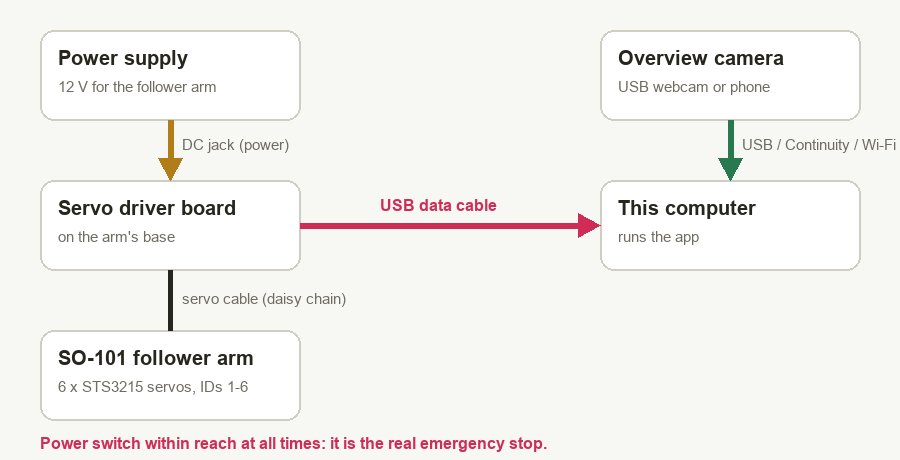

## 1 · Connect

Switch the arm's power on, plug its USB cable into the computer, pick the port and press **Connect**. The app checks that all six servos answer and shows the supply voltage and servo temperatures. On a Mac the arm appears as `/dev/cu.usbmodem…` or `/dev/cu.usbserial…`.

Then press **Run self-test**. It checks that all six servos answer and are the right model, how fast and reliable the USB link is, each servo's mode, torque limit, supply voltage, temperature and error flags, and (once the arm is calibrated) that the saved calibration matches and the wrist really bends 6° and back. Every problem comes with what to do about it. Run it again whenever something feels off.

## 2 · Arm calibration (once per arm)

The app learns how each servo is mounted. The torque switches **off**, so hold the arm, then:

### a) Reference pose

Move the arm into this "L" pose and press **Record reference pose**. It does not need to be perfect: the camera step later measures and corrects the small error.

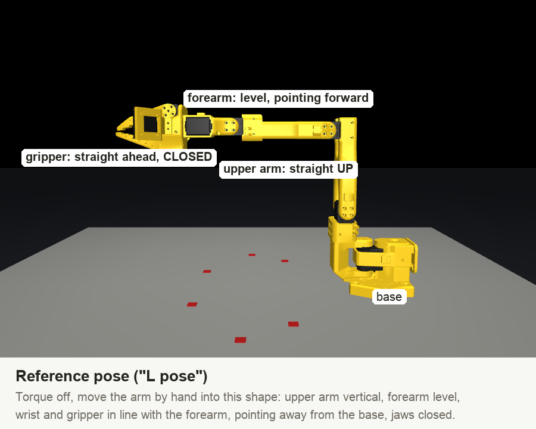

### b) Directions

For each joint the app shows one of these pictures. Move that joint the way the arrow shows, by about a quarter turn; the app moves on by itself.

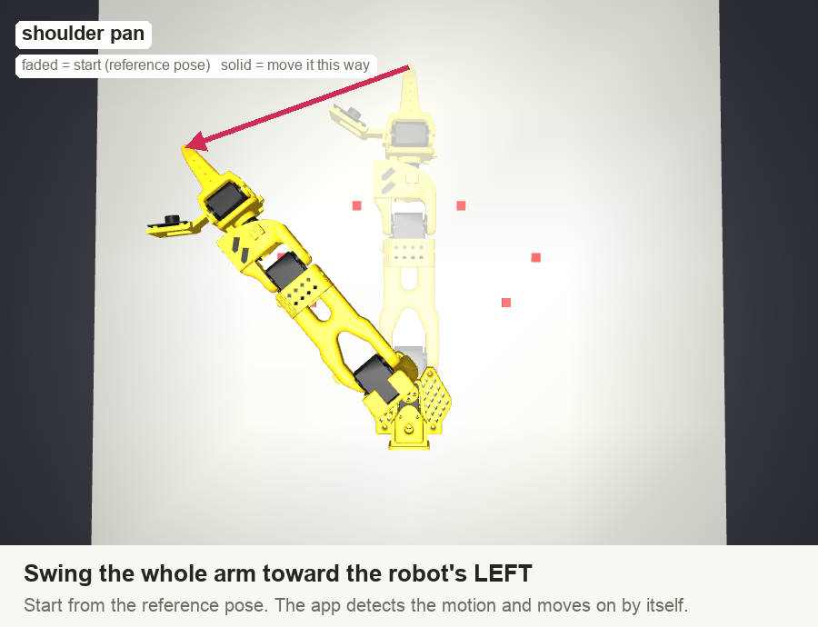

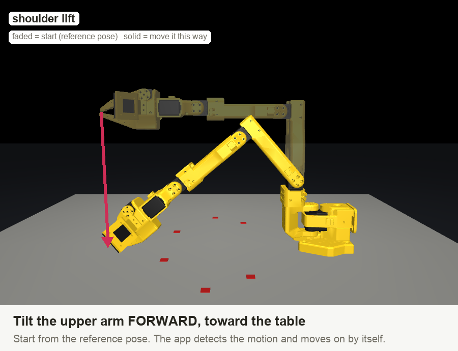

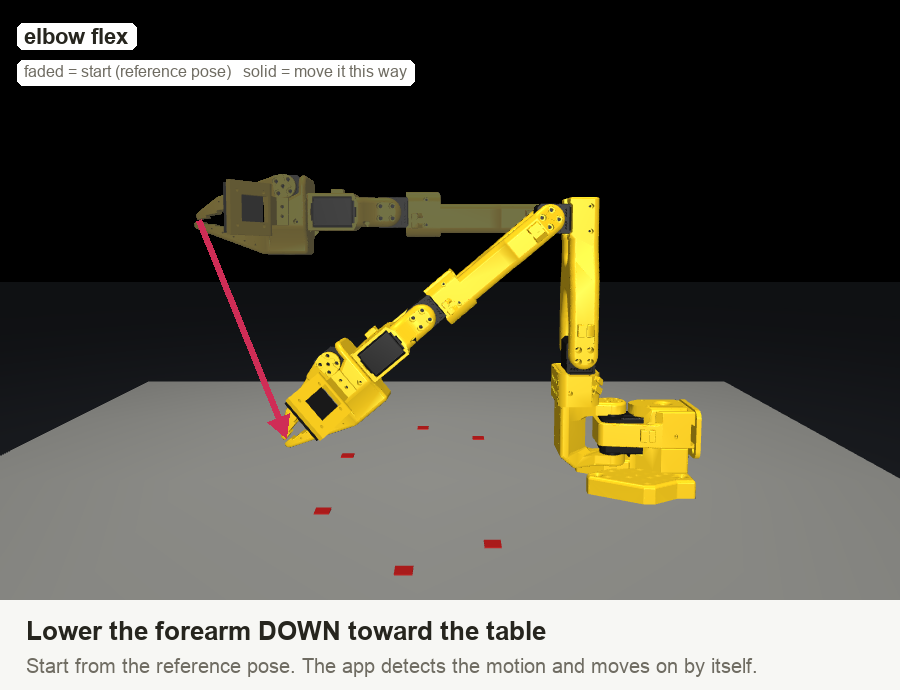

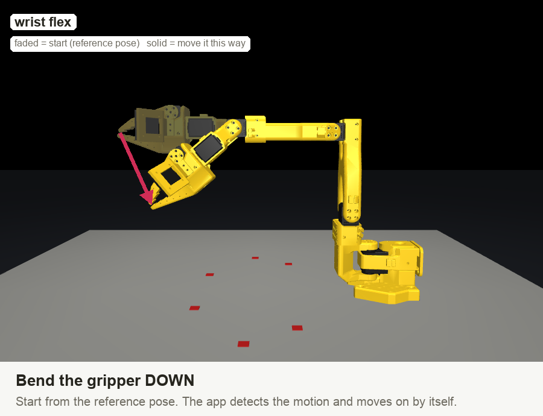

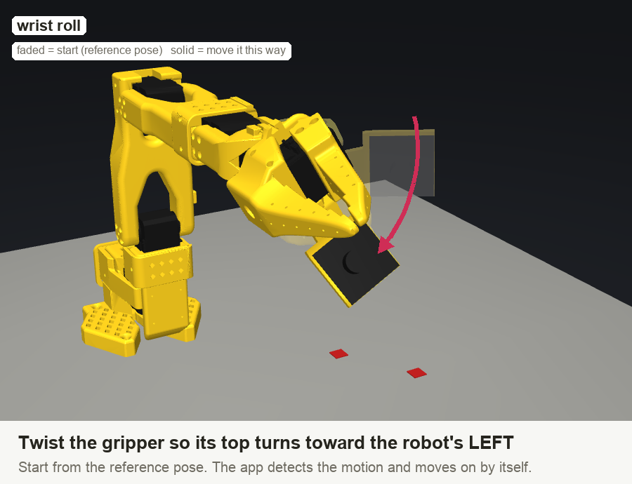

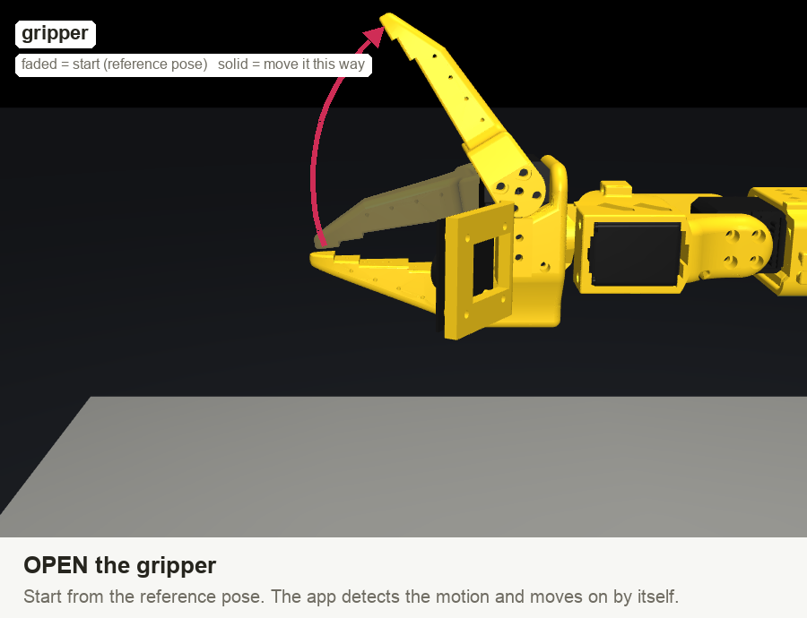

### c) Range

Move every joint slowly from one end of its travel to the other (as far as it goes without hitting the table) and open the gripper fully once. When the bars are full, press **Finish**. The limits are stored in the app and written to the servos, so they refuse to go further.

Check: with the torque off, move the arm by hand. The 3D arm must follow exactly. If one joint goes the wrong way, run the calibration again.

## 3 · Camera

Place the camera 40-55 cm from the base and 35-45 cm high, looking down at about 45°, so it sees the whole work area. Fix it firmly: if it moves, redo step 4. Light the table evenly.

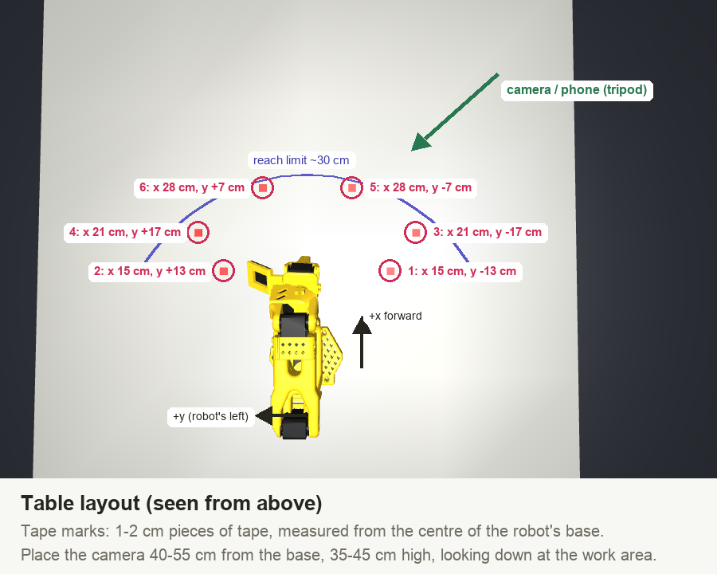

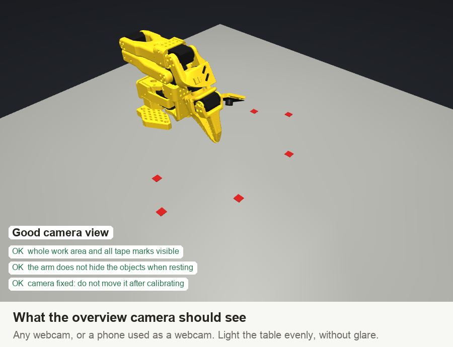

## 4 · Camera calibration

Stick 6 small tape marks on the table at the positions in the layout above (measured from the centre of the robot's base; they do not have to be exact). Clear the table of objects. Then for each mark:

1. With the torque off, close the gripper and rest the **jaw tips** on the centre of the mark.
1. Click the same mark in the camera image.

Press **Solve**. The app finds where the camera is and how wide it sees, and uses the touches to correct small arm-posing errors. A **GOOD** result is within a few pixels; a mark far off means a mis-click or a slipped touch: remove it and redo it. Then **Save**.

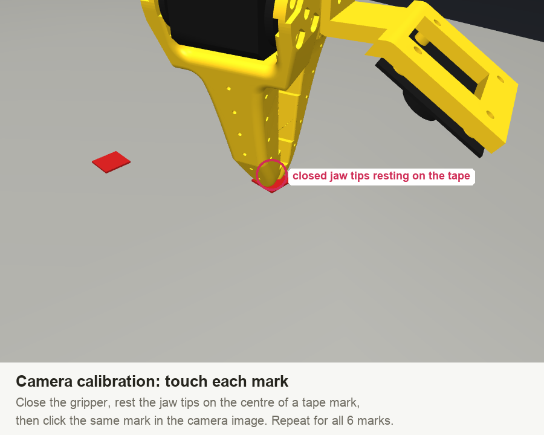

## 5 · Test

Switch the torque on, press **Home**, tick **click to hover** and click a spot on the table in the camera image: the jaw tips go 2 cm above it. If they land on the spot, you are done. Also set the speed (start at 30-40 %).

| Always-on protection | What it does |
|---|---|
| Joint limits | Commands are clipped to the calibrated range; the servos also enforce it. |
| Speed cap | Every joint's speed is limited by the Speed setting. |
| Table guard | Refuses motions that would push the gripper into the table. |
| Collision detection | A joint that strains hard but cannot follow its command stops the arm (it holds in place). |
| Watchdogs | Stops on servo overheating (65 °C) or a supply voltage drop. |
| Stop / Esc | Freezes the arm where it is, at any time, including while Claude is thinking. |

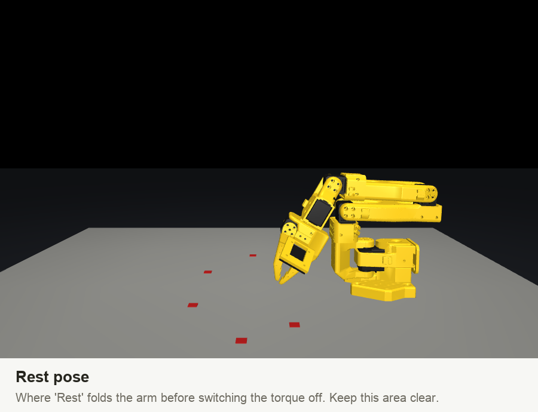

## Running tasks

Put the objects on the table, type a command and press **Run**. With the real robot, **Claude** plans and points at objects in the real camera image (the Demo planner only works with the virtual robot, which knows where its objects are). Tick **Dry run** in Options to see the plan and the motion in the 3D view without moving the arm. The first real run asks you to confirm.

Results on the real robot cannot be checked automatically; the app reports "Finished without errors" and you judge the outcome. With the virtual robot, results are verified.

## Troubleshooting

| | |
|---|---|
| Self-test: "Link speed" too slow | Use a short USB cable straight into the computer (no hub). On Linux with an FTDI adapter, set its latency timer to 1 ms. |
| Self-test: "Calibration" does not match | Another arm, or the servos were reset: run the arm calibration again. |
| "No servos answered" | Power off, wrong port (pick the follower arm, not a leader arm), or USB cable is charge-only. |
| "Servos not answering: …" | A daisy-chain cable between two servos is loose. |
| The 3D arm moves the wrong way | Redo the arm calibration; move exactly as the pictures show in the Directions step. |
| Camera does not open (Mac) | System Settings → Privacy & Security → Camera: allow the app (or Terminal when running the web version). |
| Hover test lands off the spot | The camera moved or a click was off: redo the camera calibration. |
| "… is overloaded" | Something blocked the arm. Clear it; the arm holds where it stopped. |
| "Lost the connection" | Power or USB dropped. Check both and reconnect; calibration is kept. |

Images are rendered from the robot model: `python scripts/make_robot_guide.py`.
